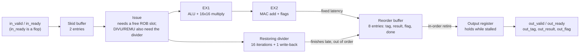
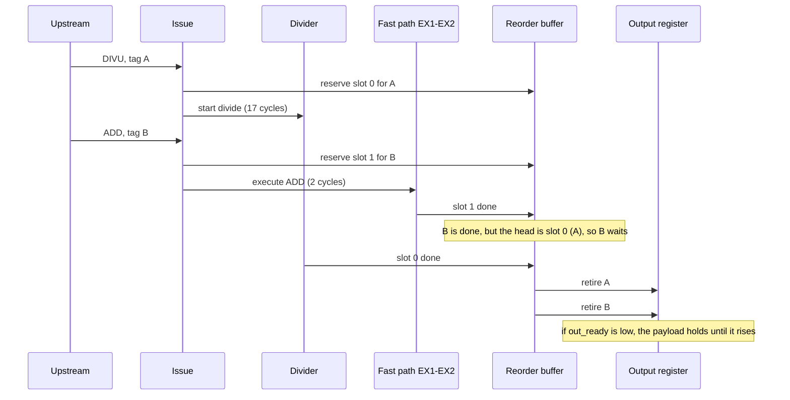
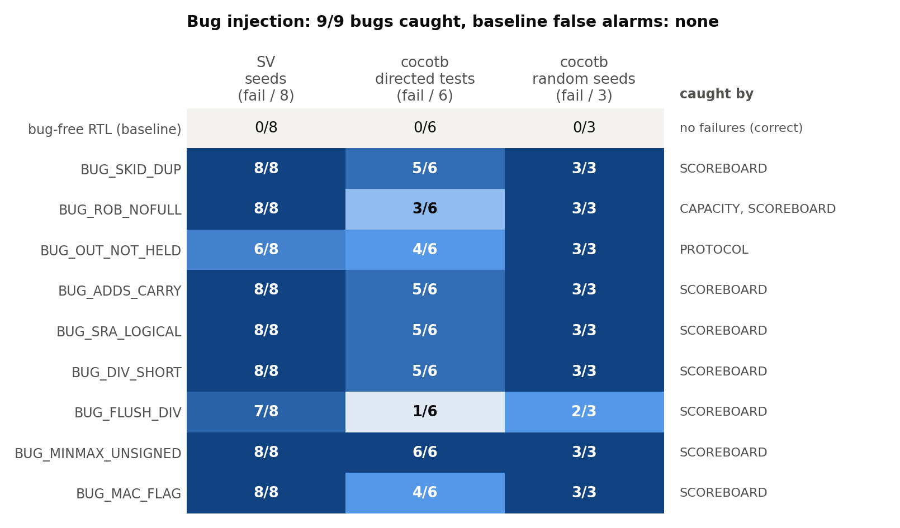
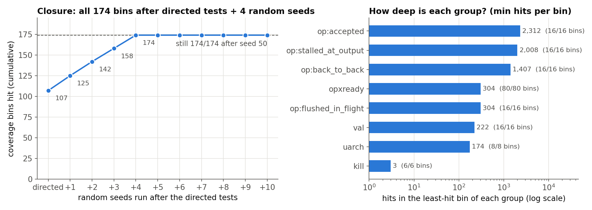
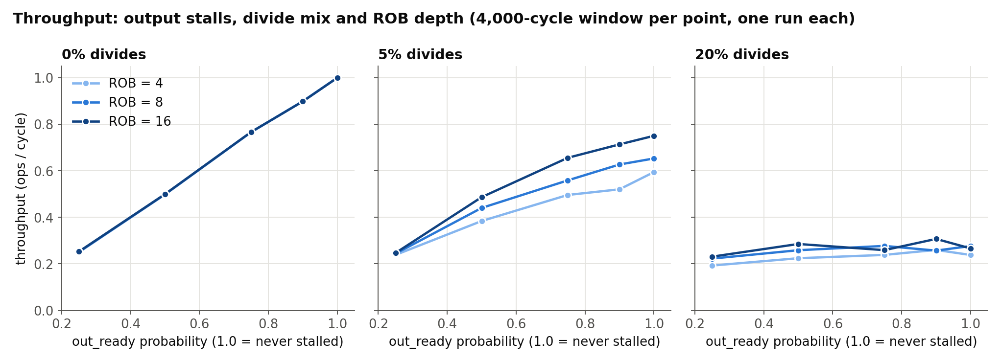

# GPU command pipeline: RTL + verification

**A small GPU-style ALU pipeline in SystemVerilog, plus two independent testbenches that spend most of their time trying to break it.**

I wanted to know how GPU teams actually convince themselves their hardware works before tape-out. From what I could find, most of the effort goes into the testbench, not the design. So I built a 16-op pipeline with an out-of-order divider and a reorder buffer, then spent most of the time trying to break it.

This is a personal, simulation-only project. Every number below comes from scripts in this repo, and the raw output is saved in [`results/`](results/).

## TL;DR

- **227,699 outputs checked over 565,955 cycles** across both benches (20 SV seeds, 6 directed cocotb tests, 50 random cocotb seeds). All runs pass on the bug-free RTL.
- **9/9 hand-injected bugs caught**, with no false alarms on the clean RTL ([`results/mutation.md`](results/mutation.md)).
- **174/174 functional-coverage bins hit**, all of them after the directed tests plus 4 random seeds. To be honest, that says my bins are fairly coarse, not that the design is proven.
- **1.000 op/cycle** with fast ops only (5-cycle latency). With 5% divides, a deeper ROB helps: **0.595 → 0.653 → 0.750 ops/cycle** at ROB = 4 / 8 / 16.

## Architecture



## What I built

**The design** ([`rtl/gpu_command_pipeline.sv`](rtl/gpu_command_pipeline.sv)): a 16-op, 16-bit command pipeline with ready/valid on both ends, an iterative divider, and an 8-entry reorder buffer.

| op | result | flag |
|---|---|---|
| ADD / SUB | a+b / a-b (wraps) | carry / borrow |
| ADDS | signed saturating a+b | 1 if it saturated |
| MUL | low 16 bits of a*b | high half non-zero |
| MAC | low 16 bits of a*b+c | result didn't fit in 16 bits |
| SHL / SHR / SRA | shift by b[3:0] | 0 |
| MIN / MAX / CMPLT | signed compare | 0 |
| AND / OR / XOR | bitwise | 0 |
| DIVU / REMU | unsigned a/b, a%b (b=0 gives 0xFFFF / a) | 1 if divide-by-zero |

Rules I fixed up front:
- **Ordering:** results leave in the order they were accepted, with the tag they came in with, even though a divide can finish after younger ops.
- **Backpressure:** once `out_valid` is high it stays high, with the same payload, until `out_ready`.
- **Flush and reset** are synchronous. They drop everything accepted but not yet emitted, including a divide halfway through. In a flush or reset cycle, `in_ready` and `out_valid` are both 0. This is the only exception to the hold rule above.
- **Parameters:** `TAG_W` and `ROB_DEPTH` (a power of two). The throughput sweep uses ROB depths 4, 8 and 16.

**Bench 1: pure SystemVerilog** ([`tb/gpu_command_pipeline_tb.sv`](tb/gpu_command_pipeline_tb.sv), needs only Icarus):
- seeded xorshift stimulus
- a golden model written as an SV function
- an in-order scoreboard
- immediate-assertion protocol checks, a watchdog and a drain check
- coverage counters

**Bench 2: cocotb + Python** ([`tb/cocotb/`](tb/cocotb/)):
- **Golden model:** [`model.py`](tb/cocotb/model.py), written from the table above.
- **Stimulus:** constrained-random and seeded. Operands are biased toward corners like 0, 1, 0x7FFF, 0x8000 and 0xFFFF. It also generates divide-by-zero, small MUL/MAC operands with a big `c`, and shifts by 0 or 15.
- **Backpressure patterns:** always ready, 90%, 50%, 25%, and bursty.
- **Scoreboard:** checks order, tag, result and flag on every output.
- **Protocol monitors:** valid/payload must hold while stalled; nothing may come out when nothing is outstanding; handshakes must be quiet during flush/reset.
- **Liveness:** a watchdog and a final drain check.
- **Directed tests:** every op against a corner-value table, a full-throughput test, freezing the output, flush corners, mid-stream reset, and a chain of divides.
- **Functional coverage:** 174 bins written by hand, because Icarus has no covergroups:
  - op × {accepted, stalled at output, back-to-back, flushed in flight}
  - op × backpressure pattern
  - value corners
  - internal events: skid full, ROB full, divider busy, out-of-order completion, both write-backs in the same cycle
  - flush while {divider busy, ROB full, output stalled, skid full}, flush twice in a row, reset with work in flight

**Bug injection:** 9 realistic bugs live in the RTL behind `ifdef`s. `make mutate` turns them on one at a time and runs both benches. If the bench doesn't fail with a bug turned on, the bench is wrong.

## How it works

The interesting part is that results finish **out of order** but have to leave **in order**. Every command reserves a ROB slot when it issues, so free slots act as credits and the execution units never have to stall. A divide takes 17 cycles, so younger fast ops finish first and wait in the ROB until the divide at the head is done:



Why each piece is there:
- **Skid buffer:** `in_ready` comes straight from a flop, so there is no combinational path from `out_ready` back upstream. The second entry catches the command that arrives in the cycle when the main register can't move. Without it you either lose full throughput or build a long ready chain.
- **ROB slots as credits:** backpressure exists at only two points, issue and the output register, which made the design much easier to reason about.
- **One divider:** only one divide can be in flight. A new divide can issue in the same cycle the old one writes back, so each divide occupies the divider for 17 cycles.

## Results

Icarus Verilog 13.0, cocotb 2.1.0, Python 3.10.8, M2 Mac. The charts are drawn by [`scripts/make_figures.py`](scripts/make_figures.py) straight from the JSON in `results/`.

### Regression

| bench | runs | cycles | outputs checked | output-stall cycles | flush cycles |
|---|---|---|---|---|---|
| pure SV | 20 seeds | 408,480 | 168,639 | 96,859 | 1,623 |
| cocotb | 6 directed tests + 50 random seeds | 157,475 | 59,060 | 41,264 | 565 |

- All runs pass on the bug-free RTL.
- Across both benches, **227,699 outputs** were checked over **565,955 cycles**.
- The cocotb runs saw 17,827 cycles where a younger op finished while an older divide was still running. Those are out-of-order completions that the ROB had to put back in order.

### Bug injection: "break it yourself"



All 9 were caught, and there were no false alarms on the clean RTL. The table is also in [`results/mutation.md`](results/mutation.md).

| bug | SV seeds failing (/8) | cocotb directed tests failing (/6) | cocotb random seeds failing (/3) | caught by |
|---|---|---|---|---|
| none (bug-free) | 0 | 0 | 0 | - |
| `BUG_SKID_DUP` (command duplicated) | 8 | 5 | 3 | scoreboard |
| `BUG_ROB_NOFULL` (overwrite un-retired slot) | 8 | 3 | 3 | scoreboard, capacity check |
| `BUG_OUT_NOT_HELD` (output changes while stalled) | 6 | 4 | 3 | protocol monitor |
| `BUG_ADDS_CARRY` (wrong saturation test) | 8 | 5 | 3 | scoreboard |
| `BUG_SRA_LOGICAL` | 8 | 5 | 3 | scoreboard |
| `BUG_DIV_SHORT` (15 iterations) | 8 | 5 | 3 | scoreboard |
| `BUG_FLUSH_DIV` (flush misses the divider) | 7 | 1 | 2 | scoreboard |
| `BUG_MINMAX_UNSIGNED` | 8 | 6 | 3 | scoreboard |
| `BUG_MAC_FLAG` (flag ignores the add carry) | 8 | 4 | 3 | scoreboard |

Try one yourself:

```sh
make sv BUG=BUG_SRA_LOGICAL      # dies with a SCOREBOARD mismatch on the first negative SRA
make test BUG=BUG_FLUSH_DIV      # only test_flush_corners fails among the directed tests (test_random catches it on some seeds)
```

### Coverage



The directed tests alone hit 107/174 bins. Random seeds 1–4 closed the rest, and nothing changed over the remaining 46 seeds. The right panel is the more honest view: the flush/reset ("kill") group closed, but its rarest bin (flush two cycles in a row) was hit only 3 times. Everything else has at least 174 hits per bin.

### Throughput (input always valid; 4,000-cycle window)



| out_ready prob | fast ops only | 5% divides, ROB=4 / 8 / 16 | 20% divides, ROB=4 / 8 / 16 |
|---|---|---|---|
| 1.0 | 1.000 ops/cycle | 0.595 / 0.653 / 0.750 | 0.238 / 0.277 / 0.267 |
| 0.5 | 0.499 | 0.384 / 0.441 / 0.487 | 0.224 / 0.259 / 0.285 |

The full sweep is in [`results/throughput.md`](results/throughput.md).

- Fast ops sustain one op per cycle, with 5-cycle latency from input handshake to output handshake when nothing stalls. With no divides, ROB depth doesn't matter: throughput just tracks `out_ready`.
- With 5% divides, a deeper ROB clearly helps, because more younger work can pile up behind a slow divide.
- With 20% divides, ROB depth stops mattering. The single divider takes 17 cycles per divide, which caps throughput at 1/(17 × 0.2) ≈ 0.294 ops/cycle, and the measured numbers sit just under that.

**What these numbers do NOT show:**
- **Each throughput point is a single random run.** There are no error bars. The 8-vs-16 difference at 20% divides (0.277 vs 0.267) is within run-to-run noise, and I'd treat the other wiggles in the 20% panel the same way.
- Ops/cycle is in *simulated clock cycles*. There is no synthesis, so there is no clock frequency, and nothing here says how fast this would be in real time.
- "9/9 bugs caught" means 9 bugs **I** wrote. That's a check that the bench isn't blind, not a measure of how many real bugs it would find.
- 174/174 coverage is 100% of **my** bins, which closed after only 4 random seeds. That points to coarse bins, not a fully proven design.

## What surprised me

- **The bug-free RTL passed on the first full run.** The real issues during bring-up were Icarus problems, not logic bugs: a signal used before its declaration, and `always_comb` with part-selects giving "sorry" warnings, so I used `always @*`. A clean first pass made me trust the bench *less*, and that's why I added bug injection. I'm not going to claim the bench found real bugs in my own design, because it didn't.
- **`BUG_FLUSH_DIV` was the hardest bug to catch.** Only 1 of the 6 directed tests caught it, and the random test caught it on 2 of 3 seeds. You need a flush during a divide, followed quickly by new work landing in the same ROB slot. That's why `kill:flush_while_div_busy` is a coverage bin.
- **`BUG_OUT_NOT_HELD` is invisible if the output is always ready.** The two SV seeds that missed it are the always-ready ones. Backpressure has to be part of the stimulus, not an afterthought.
- **The divider sets the throughput limit once divides are common.** Making the ROB bigger doesn't help past that point. Seeing the measured number land right under the back-of-envelope ceiling was satisfying.

## Run it yourself

**Prerequisites**
- [Icarus Verilog](https://steveicarus.github.io/iverilog/) (`iverilog`, `vvp`); I used 13.0. On macOS: `brew install icarus-verilog`.
- Python 3.10+ with `venv`. `make test` creates `.venv/` and installs cocotb into it on first use (I used cocotb 2.1.0).
- Optional, for the charts: matplotlib (I used 3.9.2).

**Quickstart (a few seconds once `.venv` exists; the first `make test` also installs cocotb)**

```sh
git clone https://github.com/nikhils23j/gpu-command-pipeline-ip-verification.git
cd gpu-command-pipeline-ip-verification
make sv          # pure-SV bench, only needs iverilog (SEED=, CYCLES=, BUG=)
make test        # creates .venv with cocotb on first use, runs the 7 cocotb tests
```

**Full evaluation (8 min 27 s from a clean `build/` on an M2)**

```sh
make regress                    # 20 SV seeds + 6 directed + 50 random cocotb seeds + coverage closure (~250 s)
make mutate                     # bug-injection table (~99 s)
make throughput                 # ops/cycle sweep (~157 s)
make results                    # all three above + results/results.json (tool versions, seeds, commands)
python3 scripts/make_figures.py # redraw docs/img/*.png from results/ (needs matplotlib, a few seconds)
make clean
```

## Tests

| command | what it covers | time on my M2 |
|---|---|---|
| `make sv` | Pure-SV bench, seed 1, 20,000 cycles: random stimulus and backpressure, golden-model scoreboard, protocol assertions, watchdog, drain check. Prints `SV_PASS` and coverage counters. | ~1 s |
| `make test` | All 7 cocotb tests once: `test_directed_ops`, `test_full_throughput`, `test_backpressure_freeze`, `test_flush_corners`, `test_reset_midstream`, `test_div_chain`, `test_random`. Prints `cocotb: 7/7 tests passed`. | ~2 s (plus a one-time cocotb install) |
| `make sv BUG=<name>` / `make test BUG=<name>` | The same benches against the RTL with one injected bug. These are *supposed* to fail. | same |

## Project layout

```
.
├── rtl/gpu_command_pipeline.sv      # the design (+ 9 ifdef'd bugs)
├── tb/
│   ├── gpu_command_pipeline_tb.sv   # pure-SV bench
│   └── cocotb/
│       ├── model.py                 # Python golden model
│       ├── harness.py               # drivers, monitors, scoreboard, coverage
│       ├── test_pipeline.py         # 6 directed tests + test_random
│       └── test_throughput.py       # ops/cycle measurement
├── scripts/
│   ├── run_tests.py  regress.py  mutate.py  throughput.py  summarize.py  common.py
│   └── make_figures.py              # results/*.json -> docs/img/*.png
├── results/                         # raw JSON + generated markdown tables
├── docs/img/                        # charts used in this README
└── Makefile
```

## What this isn't / limits

- **Simulation only.** No synthesis, timing, area, power, FPGA, or tape-out. I don't know its clock speed, and a 16×16 multiply plus an add in one stage might not close timing on a real flow.
- **Not a real GPU block.** It's a small ALU pipeline shaped like one stage of a GPU.
- **Not UVM, not formal, not real SV coverage.** The assertions are immediate checks, not concurrent SVA (Icarus doesn't support those). Coverage is hand-counted bins. 100% of *my* bins is not proof of correctness.
- **Both golden models were written by the same person who wrote the RTL**, so a misunderstanding of the spec could be copied into all three.
- **The mutation set is 9 bugs I wrote by hand**, not a systematic mutation tool.
- **Throughput numbers are single runs per configuration**, with no confidence intervals.

---

The numbers above come from the scripts in this repo.
